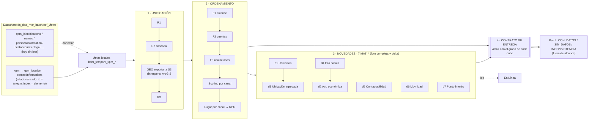
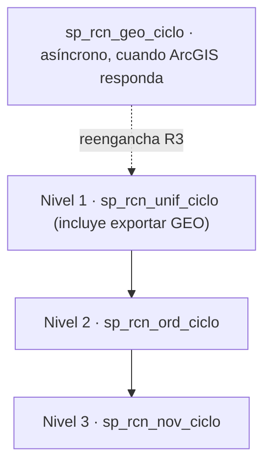

> **ESTADO: APROBADO por el usuario el 2026-10-20.** Avance por fase en `git log` de la rama `codex/ajustes-sp-reales-batch-en-linea` de los tres repos.

# Plan: Reconocer pensado desde el downstream Batch

## Contexto

El Batch (P0033 BATCH2) tiene que consumir lo que producen Unificación, GEO, Ordenamiento y Novedades. Hoy esos procesos están en Redshift y certificados con datos mock. Lo que falta:

- definir qué se le entrega exactamente al Batch;
- corregir defectos de la vía real;
- y tener observabilidad real, porque hoy la traza registra 0 filas por etapa.

**El volumen de producción es de 65 a 70 millones de contactos.** El clúster tiene 2 nodos RA3.xlplus, con Auto WLM, sin timeout y con VACUUM automático (correo del DBA, 14-oct).

Ahora contamos con el **legado completo de Reconocer**: `Novedad.sql`, `Unificacion.sql`, `Ordenamiento.sql`, `Caracteristicas.txt`, GEO y catálogos. Contamos también con una **salida real de Batch** ("Reconocer Esencial", 72 columnas).

Leerlos cambió varias premisas, y el resultado es este plan. **Las columnas tienen nombres distintos en Teradata, en EDF y en la salida.** Cada campo se homologa con evidencia y queda graduado:
- **CONFIRMADO:** el código lo muestra.
- **PROBABLE:** misma semántica o formato.
- **HIPÓTESIS:** sin rastro directo.

### Decisiones tomadas

| Tema | Decisión |
|---|---|
| Escenarios | 1 SP por escenario. La lógica certificada no se toca |
| Patrón de nombres | Solo SP reales, ahora. El mock conserva sus nombres y hay tabla de equivalencias |
| Material faltante | Tú consigues el contenido de `BATCH2_HOMOLOGACION`. `GENERACUBO` y `VALNOMBRE` no existen: su traza queda como inferida |
| Novedades | Revisar los 7 dominios: corregir los 3 portados y garantizar los 4 faltantes |
| Llave de ubicación | Medir primero. Si se confirma, derivarla de `(id, index)` y re-certificar Unificación |
| Contrato Novedades | **Foto completa + delta**, igual que el AS-IS |
| `V_Operador_Ord_Cel` | Cargar el real. Se anticipan y explican las diferencias en el mock |
| Guardar el legado | DT público, depurado, con un único push de la rama `codex/…` |
| Batch zip | Oct_16_2 más `InfoAdicional.txt` del zip anterior |
| Contactabilidad en EDF | **Verificado: no está en `edf_views`** (C1-C2, 2026-10-20). Se pide al productor; mientras tanto, NULL explícito |
| Bloqueo | **Provisional:** `blockreason` distinto de vacío y de `'0'` (436 filas). `subscriberblockstatus = 1` se trata como activo hasta que el productor lo explique |
| RF de Ordenamiento | Ya estaba en el catálogo de criterios. Se incorpora su gobernanza: bitácora de diferencias y versión de Betas (§3b) |

Catálogo, perfiles y decisiones de EDF: `dt/docs/edf_views/` (publicado en la rama `codex`).

---

## F0. Guardar el legado (primer paso, antes que cualquier código)

**Destino:** `dt/docs/legado_teradata/`, extraído en texto para poder hacer grep y diff:

```
legado_teradata/
  MANIFIESTO.md           origen, SHA-256 de cada zip, qué se excluyó y por qué
  reconocer/{unificacion,ordenamiento,novedades,geo}/   código tal cual
  reconocer/catalogos/    CSV tal cual; xlsx convertidos a CSV SIN columnas de dueño ni correo
  batch/                  Oct_16_2 + InfoAdicional.txt (del zip anterior, anotado)
  batch/Redshift_PROTOTIPO/   marcado "no es evidencia"
  batch/*.md              marcados "interpretación IA previa, no evidencia"
  salida_real_esencial/PERFIL.md   solo encabezados, formatos, estadísticas y ayudas del Excel
```

**Depuración:**
- Se excluyen `BATCH_VALFORMATO_4421_VAL.txt` y `BATCH_VALFORM_ST1`, que traen números de documento.
- Del Excel real **no se sube nada con datos personales** (cédulas, nombres, teléfonos, correos). Solo su perfil.
- Los zip originales no se suben, porque traerían lo que se depuró. Quedan su SHA-256 y su lista de archivos en el manifiesto.
- `6814c39c-Batch_Teradata_Oct_16_2.zip` es idéntico byte a byte a `642ef04c`; queda anotado.

**Además se guarda en el repo:**
- **`docs/ANALISIS_AS_IS_HOMOLOGACION.md`** con los hallazgos de las sesiones de análisis, para no perder contexto.
- El volcado de `svv_all_columns`, en cuanto me lo pases. Son solo metadatos.

**Commit y push:** un commit local en DT y **un único push de la rama `codex/ajustes-sp-reales-batch-en-linea`**. Las ramas originales no se tocan.

**Antes del push se verifica:**
- `validar.sh` sigue verde (`docs/` está fuera del chequeo ASCII);
- `git ls-tree` contra el remoto muestra los archivos.

---

## 1. Cómo funciona Reconocer, de punta a punta



**Hipótesis fuerte (PROBABLE) para el Batch:** los cubos de ubicación tienen el **mismo formato que `MAT_UBICACION_AGREGADA`**. La salida real lo respalda:
- el tipo es multivalor, `RES - LAB - CRR`, con el orden R, L, C de `Novedad.sql:5972-5977`;
- el DANE tiene 8 dígitos;
- hay número de entidades, fecha de último reporte y una posición por canal, igual que `UBICACION_ORDEN`.

Si se confirma, **Ubicación Agregada pasa a ser camino crítico del Batch**, y hoy sale vacía. Se confirma o descarta con `BATCH2_HOMOLOGACION`: su columna `HOMOLOGADO` dice de qué columna sale cada campo.



---

## 2. Qué necesita el Batch, comprobado con la salida real

| Regla | Evidencia |
|---|---|
| **Posiciones independientes por canal.** La plantilla Esencial pide Tel ×3, Dir ×3, Correo ×2 y Celular ×2 | salida real; `CUBOEXPORT_120:96,134,391,637,894` |
| La posición sale de `ORDEN_PRIORIDAD` y luego de la fecha descendente; si `ORDEN_PRIORIDAD` es nulo, la fila se descarta | `Sps_Batch.sql:4124`, `CUBOEXPORT_120` |
| **En el AS-IS, `ORDEN_PRIORIDAD` es un valor por RPU, rankeado dentro de su canal.** CEL/EMA rankean por RPU; TEL/DIR por valor, copiando el lugar a todas las RPU de ese valor | `P0027_130:136-145`, `Caracteristicas.txt` LF72/79/105/159 |
| Un CIIU válido basta para que la persona sea CON_DATOS | `Sps_Batch.sql:3812-3849` |
| Formatos de salida: fecha de actualización `dd/mm/aaaa`; fecha de expedición `dd/mm/aa`; rango de edad `36-45` con relleno; zona `URB`/`RUR`; fuente `SUS`/`CIU`/`CAM`; género `M`/`F` | perfil de la salida real |

**Lo que hoy rompe estas reglas en el repo:**
- `rpu_orden_prioridad` guarda `MIN(lugar)` mezclando canales (`sp_ordenamiento_consolidacion_edf.sql:12-24`).
- El scoring asigna el lugar a **una sola** RPU, `MIN(cod_dw_persona_ubic)`. Las RPU hermanas quedan sin orden y Novedades las descarta.

---

## 3. Hallazgos críticos AS-IS frente al repo

| # | Qué | Dónde | Prioridad |
|---|---|---|---|
| 1 | `ci.id` es el id del **arreglo** y no el del contacto (~4:1). Mezcla canales en una misma "RPU" | `02_vistas…:20-21` | P0 (D1: medir y luego `(id,index)`) |
| 2 | Lugar por canal y por RPU, no `MIN` entre canales; repartir a todas las RPU del valor en TEL/DIR | consolidación y los 4 scoring | P0 |
| 3 | **`INFO_BASICA` castea a INTEGER un hash de 64 bits: con datos reales probablemente aborta.** El mock no lo ve porque sus ids son pequeños | `sp_novedades_ubicacion_edf.sql:391` | P0 |
| 4 | El contrato de respuesta GEO no coincide con el layout del legado (Status en col28, lat 12, lon 13; barrio 7, localidad 8, estrato 9, postal 22). Se rechazaría el 100 % | `sp_geo_cargar_georreferenciacion.sql:138-169` frente a `P0006_100:29-58` | P0 (confirmar layout ArcGIS) |
| 5 | NIT cableado como `'3'`. En ID Type NH el 2 es NIT y el 3 es Persona Jurídica del Extranjero | `r2_esc3…:27`, `r2_motor_nit…:194` | P0 (validar con C5) |
| 6 | `standardizeddanecode` pasa a INTEGER (pierde el cero inicial) y cae a un **hash de cityname** cuando falta | `02_vistas…:52-58` | P0 |
| 7 | `fecha_reporte` cae a `CURRENT_DATE`; `id_buro_suscriptor` cae a una cubeta de hash; el join a counterparties es a nivel persona | `02_vistas…:319-353` | P1 |
| 8 | `bloqueado` es el literal 0. En NH, los códigos 1-9 de razón de bloqueo **no significan lo mismo** que en Teradata | `02_vistas…:195,209` | P1 (definir regla con C7) |
| 9 | `contacttype`: el mapeo 1=RES…7=DIR es inventado, JUD y CCL están invertidos, y el `'8'` entra como dirección y como teléfono | `01_ddl_unificacion…:119-128`, `04…:125` | P1 (pedir catálogo) |
| 10 | `V_Operador_Ord_Cel` inventado; el real tiene 20 filas | `02_catalogos_ordenamiento.sql:44-50` | P1 (decidido: cargar) |
| 11 | Novedades es incremental y nunca borra; el AS-IS vacía y recarga | `cargar_mat_*_edf` frente a `111.BTQ:817-836` | P1 (decidido: foto + delta) |
| 12 | Novedades: CIUDAD/DEPTO en NULL en vez de `''`; FUENTE `'CAM'` literal; sin filtro `VALIDA`; NUMERO_IDENTIFICACION = PIN | `sp_novedades_ubicacion_edf.sql` | P1 |
| 13 | Cada deploy de strct borra `unificacion_direccion` | `01_ddl_unificacion_direccion.sql:38,71,101` | P0 (DDL, con tu OK) |
| 14 | GEO: el slot 5 se usa como lote y como ruta S3; el reenganche mezcla numeración de lotes | wrappers GEO | P0 |
| 15 | `sp_ordenamiento_ejecucion_edf` está roto; `stg_ord_cta_vector` falta en el censo; el bootstrap difiere entre procesos | ver el plan anterior | P0 |

### 3b. Qué dice el RF de Ordenamiento (`Ordenamiento-CA.pdf`, 8 págs.)

**Los 90 criterios del RF ya están en `strct/20_ddl_cert_criterios_ord.sql`.** El documento no agrega criterios. Lo que sí cambia:

| Tema | El RF dice | Consecuencia para el plan |
|---|---|---|
| Ranking | "**ranking por persona y canal**… el algoritmo **no compara canales**" (§2, F4-04, Restricciones) y "cada dato vigente tiene `orden_prioridad` **dentro de su canal**" (CA-F01) | Respalda el **#2 como P0**: `MIN(lugar)` entre canales y el orden asignado a una sola RPU violan el RF, no solo el legado |
| Persistencia | `orden_prioridad` se escribe en `relacion_persona_ubicacion` (F4-06) | Un valor por RPU. Con la llave `(id,index)` cada RPU pertenece a un solo canal, así que es coherente con el #1 |
| Gobernanza | Toda diferencia Teradata ↔ Redshift se clasifica como (a) paridad, (b) cambio funcional aprobado o (c) asunto técnico pendiente, y queda en una **bitácora con decisión, fecha y responsable** (G-01..G-03, CA-M02) | **Falta.** Las divergencias viven repartidas en `CLAUDE.md`. Se crea `dt/docs/BITACORA_DIFERENCIAS.md` (F1) |
| Betas | Cada ejecución registra **qué versión de Betas usó** (G-06) | **Falta.** Se agrega `version_betas` a `ord_control` (F3, DDL) |
| Sin SQL dinámico | esquemas fijos, sin SQL dinámico (RG-07, CA-T04) | Descarta el staging por corrida con nombres dinámicos. La protección de concurrencia es **rechazar una segunda corrida en proceso** (§8) |
| Paridad | mismo corte y mismos parámetros que Teradata (G-05, CA-M01) | **Hace falta una muestra de salida Teradata** del mismo corte (ver §5) |

**El RF contradice al código legado en estos puntos.** Ya estaban detectados y el repo siguió el código, pero **ninguno está aprobado formalmente** como pide G-02. Van a la bitácora como tipo (a), paridad con el código, pendientes de aprobación:

| RF | Código legado | Evidencia |
|---|---|---|
| F3-06 "los modificados se actualizan" | el `UPDATE` está comentado "por solicitud de Experian" | `FINAL_UBIC_DIRECCIONES.sql:216` |
| F3-09 "solo cuentas activas ICBDIR" | `ICBDIR` no aparece en **todo** el legado | grep sobre `legado_teradata/` |
| F3-10 "excluir ubicaciones NO VALIDA" | `NO VALIDA` solo existe en F4 (`Caracteristicas.txt`), no en F1-F3 | grep |
| F4-TEL-02 "TEL010 = % con coincidencia geográfica" | cuota de la ventana ≤12 sobre `Total_Reportes_12` | `CAR` CR2972-2977 |
| F4-CEL-03 "CEL014 = tiene POSPAGO" | cuota de la ventana >24 | `CAR` CR2450-2453 (`POSPAGO` no aparece) |
| F4-EMA-02 "dominio conocido: gmail, hotmail, yahoo, outlook" | **5 dominios**, también `live` | `CAR` CR1091 |
| F4-CEL-06 "operador no mapeado → valor por defecto funcional" | NULL → categoría 0 | hay que fijarlo como decisión |
| F1-05 "14 tablas intermedias" / CA-T03 "se eliminan al finalizar **cada fase**" | hoy son 18 y se eliminan al final del ciclo (F3 deja insumos que usa el Scoring) | diferencia técnica (c) |

---

## 4. Contrato de datos

Archivo: `dt/docs/CONTRATO_DATOS_ENTREGA_BATCH.md`, con una tabla por cubo y este formato:

| Columna | Qué significa | AS-IS (Teradata) | Redshift | Origen EDF | Homologación | Grado | Estado |
|---|---|---|---|---|---|---|---|
| `DD_DAN_CIU` | Código DANE de 8 dígitos del centro poblado | `V_GEOGRAFIA.COD_DANE_CIUDAD` (`Novedad.sql:7665`) | `v_xpm_contacto_direccion` | `…standardizeddanecode` | `LPAD(…,8,'0')` como VARCHAR, validado contra Divipola | PROBABLE | CORREGIR (#6) |
| `DD_TIPO` | Tipo de dirección, multivalor `RES - LAB - CRR` | `V_Hom_TipoUbic_Dir_Linea` + la cadena de Agregada | — | `contacttype` | catálogo `contacttype` → abreviatura (Information Recognizer) | PROBABLE | PEDIR |

**Estados:**
- **OK:** ya fluye.
- **DERIVAR:** se calcula a partir de un dato existente.
- **CONECTAR:** está en EDF y no lo leemos.
- **CORREGIR:** se lee mal.
- **PEDIR:** hay que pedirlo o confirmarlo con el productor.
- **HOMOLOGAR:** requiere una decisión.

**Homologaciones de código ya identificadas:**

| Dominio | Teradata | EDF/NH | Puente |
|---|---|---|---|
| Tipo de identificación | `Cod_Tipo_Ident_Fte` 1-4 (+PAS, TI…) | `personidtype` (¿NH 0-10?) | ID Type NH + tabla de equivalencias (PJE↔NIT_EXT). Verificar con C5 |
| Tipo de ubicación | surrogates 21478… / RES, LAB, CRR, CCL, JUD | `contacttype` | Information Recognizer (sin JUD) + catálogo `contacttype` que hay que pedir |
| DANE | 8 dígitos (centro poblado) | `standardizeddanecode` | Divipola Villages (7.978) + DANE State Code |
| Razón de bloqueo | V_Razon_Bloqueo (18) | NH (20); los códigos 1-9 cambian de significado | **No se homologa por código.** Hay que definir qué valores significan "bloqueado" |
| Tipo de cuenta | V_Tipo_Cuenta (52) / Ord (44) | Subscriber Account Type (50 + 152 subtipos) | Coincide por código (con cero a la izquierda) |

---

## 5. Catálogos

**Ya tenemos y se usan:** betas (iguales), `V_Tipo_Cuenta_Ord` (igual), `V_Fuente`, `V_Gestion_Registro`, `V_Razon_Bloqueo`, **`V_Operador_Ord_Cel` real**, ID Type NH, Divipola + DANE State Code (sustituyen al `V_Geografia` truncado), Information Recognizer, Subscriber Account Type y Blocking Reasons.

**Faltan.** Te los pido, en este orden:

| Prio | Catálogo | Bloquea | Sustituto parcial |
|---|---|---|---|
| 1 | Catálogo de `contacttype` (EDF) → tipo/clase (RES, LAB, CRR, CCL, JUD, TEL, CEL, EMAIL) | Tipo, clase y llave de canal | — |
| 1 | `V_Hom_Tip_Ident_Linea` (o equivalencias NH↔Teradata) | Agregada vacía, tipo de identificación en 5 dominios | ID Type NH |
| 1 | `V_ACTIVIDAD_ECONO_CIIU` | Descripción y versión del CIIU (cubo CIIU, Info Básica) | — |
| 1 | Layout real de respuesta de ArcGIS | Carga GEO; barrio, localidad, estrato, postal | P0006 del legado (30 columnas) |
| 1 | Regla de bloqueo en EDF (`blockreason` / `subscriberblockstatus`) | Exclusión de bloqueadas | — |
| 2 | `V_Hom_TipoUbic_Dir_Linea`, `V_TIPO_UBICACION` | Tipo y clase | Information Recognizer |
| 2 | `V_ZONA_UBICACION` + `V_Hom_Zona_Linea`, `V_ESTRATO_DIRECCION` | Zona, estrato | `xpm_location.stratum` (por validar) |
| 2 | `V_TELEFONO_FIJO`, `V_TIPO_CORREO` / `V_DIRECCION_ELECTRONICA` | Indicativo, tipo de correo | `V_Geografia.Indicativo` (aproximado) |
| 2 | `V_RANGO_EDAD`, `V_GENERO`, `V_JERARQUIA_GEOGRAFICA` | Cubo PERSONA / Info Básica | rangos reconstruibles desde `InfoAdicional`; Divipola |
| 3 | Contactabilidad: `V_CONTACTABILIDAD`, `V_CONTACTO_EFECTIVO`, `V_PRIORIDAD_GESTION_*`, clase buró; `V_Ind_Efectiv_Orden_Peso_Email` | d5, columnas de gestión del cubo, `EMA020` | — (**verificar con C3**) |
| 3 | Movilidad: `V_PERSONA_INDICADOR_MOVILIDAD`, `V_INDICADOR_MOVILIDAD`, `V_Hom_Ind_Mov_Linea` y el productor `MTCalcularIndicadoresMovilidad` | d6 | — |
| 3 | Punto de interés: `V_PUNTO_DE_INTERES_GEO`, `V_TIPO_PUNTO_INTERES`, `V_Hom_Tipo_Pto_Int_Linea`, `PRO_HOMOLOGACION_GEO` | d7 | `geo_distancias` (le falta el nombre del PI) |
| 3 | Batch: `BATCH2_HOMOLOGACION` (ya lo pides), `V_CATEGORIA_INGRESO/EGRESO`, contenido de `V_TIPO_IDENTIFICACION`, definición de `Vstg_BUROPERS_TMP` | contrato del Batch | — |
| — | `V_Geografia` y `V_Cod_Entrega_Dato` llegaron **truncados a 1000 filas** | | Divipola para Geografía |
| 1 | **Muestra de salida Teradata de Ordenamiento** para un mismo corte: distribución agregada de `Orden_Prioridad` por canal y número de RPU con orden, o una llave hasheada | paridad G-05 / CA-M01 | — |

**Actualizado con EDF (2026-10-20, `dt/docs/edf_views/`):**
- Contactabilidad y gestión **no están** en `edf_views` (verificado): hay que pedirlas.
- Barrio, localidad, código postal, estrato, web, identificación, expedición, nombres, género, rango de edad, CIIU (principal con descripción y secundarios) y cuentas **sí existen**. Dejan de pedirse `V_ESTRATO_DIRECCION`, `V_JERARQUIA_GEOGRAFICA`, `VU_PERSONA` y el layout GEO para barrio, localidad y postal.
- Siguen haciendo falta los catálogos de **códigos**: género, `contacttype` y `V_ACTIVIDAD_ECONO_CIIU` para los CIIU secundarios.
- Bloqueo: **regla provisional** = `blockreason` distinto de vacío y de `'0'`. NIT = código 2 (confirmado con datos).

---

## 6. Novedades: 7 dominios, foto completa + delta

| | Dominio | Hoy | Acción |
|---|---|---|---|
| d1 | Ubicación | portado | Corregir #3, #6, #12; agregar filtro `VALIDA`; clases TEL/CEL/EMAIL; foto + delta |
| d2 | Actividad económica | portado | Universo = todas las actividades de Info Básica (no solo la principal); `FECHA_REPORTE` = inicio de relación o matrícula; llave de severidad (info, CIIU, fecha) |
| d3 | Ubicación agregada | portado, **vacío** | Depende de tipo de identificación (#1 de faltantes); COD_PAIS, cadenas TIPO y FUENTE; vista delta |
| d4 | Info básica | no portado | Portar sobre `xpm_identifications`/`names`/`personalinformation`, tras C2. Alimenta PERSONA y la llave de d2, d3, d6 y d7 |
| d5 | Contactabilidad | no portado | Decidir tras C3 |
| d6 | Movilidad | no portado | Requiere el productor P0029 (`MTCalcularIndicadoresMovilidad` no viene en el zip) |
| d7 | Punto de interés | no portado | Sobre `geo_distancias` + catálogos de PI |

**Mosaic queda excluido, y eso tiene un costo:** `140.BTQ:515-527` exige que cuadre `MOSAIC.txt` antes de exportar. La validación de extractos de En Línea hay que rehacerla.

---

## 7. Patrón de nombres (solo SP reales)

```
sp_rcn_<proceso>_<fase>_<nn>_<que_hace>
proceso: unif | geo | ord | nov | ctl     fase: r1 r2 r3 | f1 f2 f3 sc | d1..d7
```

| Hoy | Nuevo |
|---|---|
| `sp_unificacion_ciclo` / `19_sp_ordenamiento_ciclo` / `sp_novedades_ciclo_edf` | `sp_rcn_unif_ciclo` / `sp_rcn_ord_ciclo` / `sp_rcn_nov_ciclo` |
| `sp_unificacion_r1_esc1_ciiu10_mismo_texto_padre_lab_crr` | `sp_rcn_unif_r1_01_ciiu10_mismo_texto` |
| cascada R2 (L3 → X4 → B5 → A6 → D9 → C7 → A8 → E6) | `sp_rcn_unif_r2_03_l3_…` … `_10_e6_…` (el número fija el orden) |
| `sp_geo_*` | `sp_rcn_geo_01_exportar` … `_04_reenganchar_r3`, `sp_rcn_geo_ciclo` |
| `sp_ordenamiento_{preparar_insumos,cuentas,ubicaciones}_edf` | `sp_rcn_ord_f1_alcance`, `_f2_cuentas`, `_f3_ubicaciones` |
| scoring ×4, consolidación, drop staging | `sp_rcn_ord_sc_01_dir` … `_05_consolidar`, `sp_rcn_ord_99_limpiar` |
| `sp_novedades_<dom>_edf` + `cargar_mat_<dom>_edf` | `sp_rcn_nov_dN_<dom>_calcular` + `_cargar` |

**Reglas del renombrado:**
- Las firmas no cambian.
- Cada renombre lleva su DROP en `RevSQL/` y su línea en los dos `.par`.
- Los SP compartidos con el mock se renombran; en el mock solo cambia la línea `CALL`.
- `sp_ordenamiento_ejecucion_edf` se retira.
- La tabla de equivalencias va en `dt/docs/PATRON_NOMBRES_SP.md`.

---

## 8. Observabilidad y control

Se conservan las tablas actuales (`*_control`, `*_control_etapa`, `unif_escenario_censo`, `geo_lote_control`, `ord_alcance_censo`) y se llenan de verdad:

- **Filas reales:** entrada y salida en cada paso. Hoy son 0.
- **Tiempo real por escenario:** se mide dentro de cada `sp_rcn_unif_rN`. Hoy la R2 tiene tiempos ficticios.
- **Censo de las tres reglas:** se extiende a R1 y R3.
- **Novedades:** `EXCEPTION` y validación de lote y modo.
- **GEO:** `corrida_id` en `geo_lote_control` (DDL).
- **Etapa:** columna a `VARCHAR(64)` (DDL).
- **Concurrencia:** se rechaza abrir una corrida si ya hay otra en proceso. No se aíslan los nombres de staging por corrida, porque el RF prohíbe el SQL dinámico (RG-07).
- **Betas:** `ord_control` registra qué versión de Betas usó cada corrida (G-06, DDL).

---

## 9. Consultas a EDF que necesito (solo lectura, agregadas, sin datos personales)

| # | Para qué | Consulta |
|---|---|---|
| C1 | Tablas del datashare | `SELECT schema_name, table_name, table_type FROM svv_all_tables WHERE database_name='ds_dba_rncr_batch' AND schema_name='edf_views' ORDER BY 2;` |
| C2 | Todas las columnas | `SELECT table_name, ordinal_position, column_name, data_type FROM svv_all_columns WHERE database_name='ds_dba_rncr_batch' AND schema_name='edf_views' ORDER BY 1,2;` |
| C3 | ¿Hay contactabilidad o gestión? | `…svv_all_columns… AND (column_name ILIKE '%contact%' OR column_name ILIKE '%gestion%' OR column_name ILIKE '%effect%' OR column_name ILIKE '%result%' OR column_name ILIKE '%call%' OR column_name ILIKE '%attempt%') ORDER BY 1,2;` |
| C4 | Llave `(id, index)` | `SELECT COUNT(*) filas, COUNT(DISTINCT id) ids, COUNT(DISTINCT id::VARCHAR||':'||"index"::VARCHAR) id_index FROM ds_dba_rncr_batch.edf_views.xpm_location_val_contactinformations;` y la distribución de canales por id |
| C5 | Dominio de tipo de identificación | `SELECT "location.val.personidtype", COUNT(*) FROM …xpm_location GROUP BY 1 ORDER BY 2 DESC;` |
| C6 | Dominio de `contacttype` y largo del DANE | `GROUP BY "…contacttype"` y `GROUP BY LEN(TRIM("…standardizeddanecode"))` |
| C7 | Valores de bloqueo | `SELECT "location.val.blockreason", "location.val.subscriberblockstatus", COUNT(*) FROM …xpm_location GROUP BY 1,2;` |

Con C1-C2 preparo las consultas de unicidad, huérfanos y fan-out para `xpm_identifications`, `xpm_names`, `xpm_personalinformation` y `xpm_bestaccounts`, usando los nombres exactos. El resultado de C1-C3 **se guarda en el repo**.

---

## 10. Fases (commits locales; el único push es el de F0)

| Fase | Entrega | Necesita de ti |
|---|---|---|
| **F0** | Guardar el legado + `ANALISIS_AS_IS_HOMOLOGACION.md` + corregir las afirmaciones falsas de `CLAUDE.md`/docs que desmiente el legado. Ejemplos: "el AS-IS solo inserta/actualiza", "ACTECO solo crece", citas `:288/:1721/:4808` equivocadas, dos numeraciones de `Caracteristicas.txt` | — |
| **F1** | Docs: `CONTRATO_DATOS_ENTREGA_BATCH.md` (con grados), `PATRON_NOMBRES_SP.md` y **`BITACORA_DIFERENCIAS.md`** (G-01..G-03: cada diferencia RF/legado/Redshift con tipo a/b/c, decisión, fecha y responsable; arranca con las 8 de §3b y las 15 de §3) | Aprobación funcional de las diferencias tipo (b) |
| **F2** | Correcciones P0 sin dependencias externas: #3, #6, #7, #14, #15; cargar el `V_Operador_Ord_Cel` real | — |
| **F3** | Observabilidad real (sección 8) | OK al DDL |
| **F4** | Renombrado al patrón (estructural) | — |
| **F5** | Conectar EDF: llave `(id,index)` (#1), lugar por canal (#2), tipo de identificación (#5), bloqueo (#8), `contacttype` (#9), cuentas | Resultados de C1-C7; catálogos de prioridad 1 |
| **F6** | Novedades foto + delta; d1-d3 corregidos; d4 y d7 portados; d5 y d6 según catálogos | Catálogos de prioridad 2-3 |
| **F7** | Contrato de entrega: vistas con el grano de cada cubo | `BATCH2_HOMOLOGACION` |
| — | #4 GEO y #13 `unificacion_direccion` | Layout de ArcGIS; OK al DDL |

---

## 11. Verificación

- **`./validar.sh`** en los 3 repos, en cada fase.
- **Banco local** (PostgreSQL 16; el contenedor tiene 4 CPU y 15 GB, no lo puedo agrandar desde aquí):
  - `fase strct`, luego `fase pgm` (compila todo);
  - luego `fase dt` **dos veces**, para reproducir el doble DPLY de Jenkins.
- **Mock:**
  - En F4 (renombrado) el tablero debe quedar idéntico: Unificación 174, Novedades 63, `CA-F03` 15/15, `grupos_con_empate`.
  - En F2, F5 y F6 cada diferencia se anticipa y se explica. Ejemplos: el operador CEL real mueve los scores de CEL; `(id,index)` mueve Unificación.
- **Renombrado:** diff bidireccional en cero. Los cuerpos normalizados son idénticos salvo el nombre y los `CALL`.
- **Datos reales:** solo con las consultas de lectura que corres tú.
- **Jenkins DEV:** solo con un push autorizado. El push de F0 lleva solo `docs/`, no toca `deploy/redshift`.
